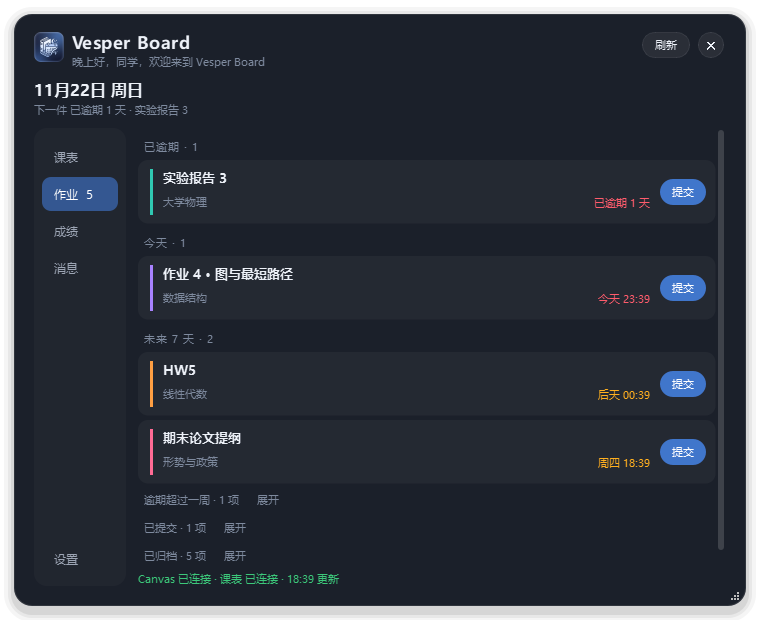

<p align="center">
  
</p>

<h1 align="center">Vesper Board · 晚星看板</h1>

<p align="center">
  <a href="README_en.md">English</a> ｜
  简体中文
</p>

<p align="center">
  
  
  
  
  
  <a href="LICENSE"></a>
</p>

<p align="center">
  <a href="#功能">功能</a> ｜
  <a href="#安装">安装</a> ｜
  <a href="#第一次使用">第一次使用</a> ｜
  <a href="#日常使用">日常使用</a> ｜
  <a href="#隐私与安全">隐私与安全</a> ｜
  <a href="#常见问题">常见问题</a> ｜
  <a href="#参与开发">参与开发</a> ｜
  <a href="#许可证与声明">许可证</a> ｜
  <a href="SECURITY.md">安全策略</a>
</p>

Vesper Board 是桌面上的一颗悬浮球：点开就是**还没交的 Canvas 作业**和**今天的 AMS 课表**，作业可以直接在球里选文件提交。它常驻屏幕边缘，不打扰你，鼠标移上去才滑出一条「上课中 / 下一节 / 下一件」。

它不是企业微信或 i西湖的插件（那套客户端不开放第三方插件接口），而是一个独立的桌面小工具，用 Canvas 的 REST API 和学校统一身份认证拿数据。

> 个人作品，与西湖大学官方无关，未获学校背书或授权。使用前请自行确认符合学校与
> Canvas 的使用规定；Canvas 的访问令牌等同你账号的完整 API 权限，只应留在本机。

<p align="center">
  
</p>

## 功能

- **作业**：按逾期 / 今天 / 明天 / 未来 7 天 / 更晚分组，可折叠；重名课程自动合并；`submission_types: ["none"]` 的条目收进「仅提醒」，不占待交数。
- **提交**：选多个文件 → 确认 → Canvas 三步上传；交过的收进「已提交 · N」，按钮变成「新提交」（会覆盖旧提交）。
- **详情**：老师给的说明正文、附件、课程文件，都能直接打开或下载到 `~/Downloads/VesperBoard/`。
- **归档**：免修、换课、助教批改的作业右键收进「已归档」，不再出现在清单和数字里，随时可恢复。
- **课表**：今天 + 本周七天，教室名清洗成 `E13-207` 这种；正在上的课会标「进行中」。
- **成绩与消息**：成绩按课程合并，展开能看到是哪次作业拿的分；Canvas 公告与 AMS 通知合并在一个页签，单条已读，侧栏有红点。
- **提醒**：开课前 N 分钟提醒一次，DDL 前 2 小时提醒，勿扰时段内一律不弹；也可以对单条作业挑具体时间。
- **早报与角标**：每天第一条刷新报今天几节课、几个待交、最近一件是什么；角标可显示待交数量，或「离最近截止还有多久」（`-2h` = 逾期两小时）。
- **形象**：小西七种状态（idle / hover / syncing / class / urgent / done / error），卡片式切换，64–200 px 可调；支持导入自己的形象，格式见 [docs/custom-skin.md](docs/custom-skin.md)。
- **主题**：跟随系统 / 浅色 / 深色，切换即时生效；光晕与右上角标点默认关闭。
- **其它**：专注 25 分钟、导出 `.ics`、中英双语、开机自启、托盘菜单、气泡说话。

## 数据从哪来

| 功能 | 数据来源 | 方式 |
|---|---|---|
| 待交作业 | Canvas `api/v1/courses` + `assignments` | 官方 REST API，按提交状态过滤 |
| 球里快速提交 | Canvas 文件上传三步接口 | 选文件 → 确认 → 上传 → 提交 |
| 当天课表 | AMS `portal-service/api/v1/schedule/get-calendars` | 复用统一身份认证后的会话 cookie |
| 成绩 / 公告 | Canvas 成绩与 `announcements` | 官方 REST API |
| AMS 通知 | AMS 通知接口 | 与会话 cookie 同一来源 |

## 安装

需要 **Windows 10 / 11**，或者 64 位 Linux 桌面；macOS 提供 Apple 芯片的未签名包（CI 构建），Intel Mac 可从源码运行。

### Windows

- **安装包**：运行 `VesperBoard-1.0.0-setup.exe`。默认装到 `%LOCALAPPDATA%\Programs\VesperBoard`，不需要管理员权限；会创建桌面与开始菜单快捷方式。
  安装包没有代码签名，SmartScreen 可能提示「Windows 已保护你的电脑」，点「更多信息」→「仍要运行」。
- **免安装**：解压 `VesperBoard-1.0.0-win-x64.zip`，运行里面的 `VesperBoard.exe`。
- **静默安装**：`VesperBoard-1.0.0-setup.exe /S`，默认保留已有数据。

### Linux

- 解压 `VesperBoard-1.0.0-linux-x86_64.zip`，运行 `VesperBoard/VesperBoard`。
  zip 里保留了符号链接，请用会保留链接的 `unzip`、`bsdtar` 或文件管理器解压；
  用 Python 的 `zipfile` 解压会把链接写成文本文件，程序起不来。
- 或者安装 `.deb`（由 `packaging/build_deb.sh` 生成）。

### macOS

从 Release 下载 `VesperBoard-v1.0.0-macOS-arm64.zip`（Apple 芯片；由 CI 在 macOS runner 上构建）。

- 这是**未签名、未公证**的 `.app`：解压后首次打开会被 Gatekeeper 拦下，
  右键 →「打开」→「打开」，或执行 `xattr -dr com.apple.quarantine "Vesper Board.app"`。
- Intel Mac 目前没有预编译包，可从源码运行（`python main.py`），或自己用仓库的
  `.github/workflows/build-desktop.yml` 在 Intel runner 上构建。

### 从源码运行

```powershell
python -m pip install -r requirements.txt
python main.py
```

需要 Python 3.12。Linux 还要有 X11、`libxkbcommon`、`libnss3` 等常规 Qt 依赖。

## 第一次使用

1. 启动后，悬浮球出现在屏幕右侧（位置会记住）。
2. 左键点球打开面板 → 侧栏「设置」→「账号」。
3. 点「登录」，用学校统一身份认证在**应用内窗口**里登录一次。密码只输在学校自己的页面上，程序只保存登录后的会话 cookie，并用系统凭据保护（Windows DPAPI / macOS 钥匙串 / Linux secret-tool）。
4. 登录成功后会自动带出 Canvas 与 AMS 两个会话；面板底部会显示「Canvas 已连接 · 课表 已连接」。

也可以在「账号」页手工粘贴 Canvas 个人访问令牌（旧方式），但登录窗是推荐路径。
令牌等同于账号的完整 API 权限，只应留在本机。

## 日常使用

- **悬停球**：向左滑出「上课中 / 下一节 / 下一件」。
- **左键点球**：展开 / 收起面板。
- **拖动球**：放到任意位置，松手自动吸附屏幕边缘。
- **右键球**：菜单（打开面板 / 立即刷新 / 设置 / 置顶显示 · 普通窗口层 · 贴桌面 / 退出）。
- **作业行**：点「提交」选文件 → 确认后上传；点行本身打开详情；右键可归档或设提醒。
- **课表行**：显示时间、课程、教室、老师；正在上的课高亮。
- **Esc**：收起面板。
- 托盘图标有同样的菜单。

## 隐私与安全

- 不保存密码，不碰企业微信 / i西湖的数据库，**没有遥测，不向开发者回传任何数据**。
- 带凭据的请求只发往 `canvas.westlake.edu.cn` 与 `ams.westlake.edu.cn`。
  上传/下载落到对象存储时改用不带 `Authorization`、不带 cookie 的独立连接；
  Canvas 返回的跨来源回调一律拒绝。
- 只有你点「提交」并在确认框里确认后，选中的文件才会交给 Canvas；Canvas 可能把文件转存到它自己的对象存储。
- 令牌与会话用 **Windows DPAPI** 加密存本机（`%LOCALAPPDATA%\VesperBoard\*.bin`）；
  macOS 用钥匙串，Linux 用 `secret-tool`，没有 `secret-tool` 时降级为 0600 的 `.plain` 文件。
- 内嵌浏览器（QtWebEngine）使用内存 cookie，不落盘；启动时会清理旧版本留下的明文 cookie 库。
  但 Chromium 自己的 profile 里仍可能有缓存与站点数据，介意的话可删除 `web-profile/` 与 `web-cache/`。
- 卸载时选择「同时删除本机数据」，会清掉 `%LOCALAPPDATA%\VesperBoard` 与改名前的 `%LOCALAPPDATA%\WestlakeDock`。
- 令牌权限范围：Canvas 个人访问令牌不分权限，等同于账号的完整 API 权限。别把它复制到网盘、聊天或截图里。
- 详细审计记录见 [docs/security-audit.md](docs/security-audit.md)，漏洞报告流程见 [SECURITY.md](SECURITY.md)。

## 常见问题

**球变灰了** —— Canvas 连不上：检查校园网 / VPN，或令牌是否过期（设置 → 账号 → 测试）。

**作业列表是空的** —— Canvas 只返回「已选课且已发布」的作业；没截止时间的会排在最后。

**提交失败** —— 只有 `submission_types` 含 `online_upload` 的作业能在球里交；其他类型会显示「打开」，跳转到 Canvas 网页提交。

**AMS 一直失败** —— 先确认浏览器里能打开课表页，再在设置里点「登录」重新走一遍统一身份认证。

**登录页白屏** —— 旧版本残留的会话 cookie 会造成 `canvas ↔ iam` 循环重定向；1.0.0 起主动登录会使用干净的内存会话，仍有问题请提 issue 并附上 `dock.log`。

**卸载删不掉数据** —— 卸载器会先结束正在运行的实例；选择「删除数据」时会同时清理新旧两个数据目录。

## 参与开发

```powershell
python -m pip install -r requirements.txt -r requirements-build.txt
python main.py                     # 运行
python -m pytest tests -q          # 离线单测，不联网
python packaging/make_icon.py      # 由 assets/app_icon.png 生成 build/icon.ico / png
```

打包（详见 [packaging/README.md](packaging/README.md)）：

```powershell
python -m PyInstaller packaging/WestlakeDock.spec --noconfirm --clean --distpath dist --workpath build/pyinstaller
```

Linux 包可在 WSL 里用 `scripts/wsl_build_linux.sh` + `scripts/wsl_pack_linux.sh` 交叉构建。

```
Vesper_Board/
├─ main.py              入口：悬浮球、面板、托盘、气泡
├─ wsdock/              数据层与界面（canvas / ams / worker / ui / theme）
├─ assets/              运行时素材：形象、图标
├─ docs/                设计笔记、导入格式、安全审计
├─ packaging/           PyInstaller spec、安装器脚本
├─ scripts/             WSL 交叉构建辅助
├─ tests/               离线单元测试
└─ licenses/            随安装包分发的许可证全文
```

## 报告问题

**普通缺陷 / 功能建议**：请发到仓库的 [Issues](https://github.com/JiamingShi-JsPhys/vesper-board/issues)。请附上版本号、复现步骤，以及 `dock.log` 里相关的几行。

**安全漏洞（仅限此类）**：请**不要**用公开 Issues。请邮件至 `jiamingshi_git@outlook.com`。

- **标题**：必须以 `report_vesper-board:` 前缀开头，后接简短摘要。
  - 示例：`report_vesper-board: upload sends token to object storage host`
- **正文**：必须包含复现步骤、确切命令行与环境（Windows 版本、Vesper Board 版本）。

提交清晰、可复现的 issue 或 PR 的贡献者，会在下一个版本的发布说明与致谢中列出。

---

## 作者与维护者

Jiaming Shi · [@JiamingShi-JsPhys](https://github.com/JiamingShi-JsPhys)

## 致谢

感谢 Qt for Python / PySide6、requests、Python 的维护者，以及所有提交 issue 与 PR 的同学。
贡献者名单会随版本更新。

## 商标声明

"Canvas" 是 Instructure, Inc. 的商标；「西湖大学」名称与校徽归学校所有；「小西」等角色形象归其原作者或权利方所有。
本项目是独立的第三方工具，与上述主体没有隶属、赞助或背书关系，仅为说明数据来源与兼容对象而提及这些名称。

## 开源许可

代码目前为「保留所有权利」，详见 [LICENSE](LICENSE)；美术素材不在代码许可范围内。
第三方组件：PySide6 / Qt（LGPL-3.0）、requests（Apache-2.0）、Python（PSF-2.0），
安装目录下的 `licenses/` 附有完整文本，索引见 [THIRD_PARTY_LICENSES.txt](THIRD_PARTY_LICENSES.txt)。
