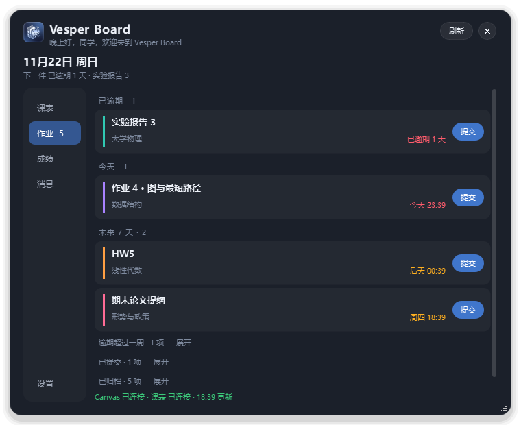

<p align="center">
  
</p>

<h1 align="center">Vesper Board</h1>

<p align="center">
  English ｜
  <a href="README.md">简体中文</a>
</p>

<p align="center">
  
  
  
  
  
  <a href="LICENSE"></a>
</p>

<p align="center">
  <a href="#features">Features</a> ｜
  <a href="#install">Install</a> ｜
  <a href="#first-run">First run</a> ｜
  <a href="#day-to-day">Day to day</a> ｜
  <a href="#privacy--security">Privacy</a> ｜
  <a href="#faq">FAQ</a> ｜
  <a href="#development">Development</a> ｜
  <a href="#license--notices">License</a> ｜
  <a href="SECURITY.md">Security</a>
</p>

Vesper Board is a small floating ball that lives at the edge of your screen. Open it and you get the **Canvas assignments you still owe** and **today's AMS timetable**; you can pick files and submit an assignment right from the ball. Hover it and a strip slides out with "in class / next class / next due".

It is not a plugin for WeCom or iWestlake — those clients do not expose a third-party plugin API. It is a standalone desktop widget that talks to the Canvas REST API and the school's single sign-on.

> A personal project. Not affiliated with, endorsed by, or authorised by Westlake University.
> Check that your use complies with your school's and Canvas's rules. A Canvas access token
> carries your account's full API permissions — keep it on your own machine.

<p align="center">
  
</p>

## Features

- **Assignments**: grouped into overdue / today / tomorrow / next 7 days / later, collapsible, with duplicate course names merged. Entries Canvas marks `submission_types: ["none"]` go to "reminder only" and do not inflate the count.
- **Submit**: pick multiple files → confirm → Canvas's three-step upload. Submitted work moves to "Submitted · N" and the button becomes "Resubmit" (which really does submit again).
- **Details**: the teacher's description, attachments and course files, openable or downloadable to `~/Downloads/VesperBoard/`.
- **Archive**: right-click an assignment you are exempt from; it leaves the list and the badge, and can be restored.
- **Timetable**: today plus the next seven days; room names are cleaned to `E13-207`; the current class is highlighted.
- **Grades and messages**: grades merged per course with the individual items behind them; Canvas announcements and AMS notices share one tab with per-item read state and a sidebar dot.
- **Reminders**: before class, two hours before a deadline, silenced during quiet hours; you can also pick an exact time per assignment.
- **Daily brief and badge**: the first refresh of the day reports classes, open assignments and the nearest one; the badge shows the count or the time left (`-2h` = two hours overdue).
- **Characters**: seven states (idle / hover / syncing / class / urgent / done / error), card picker, 64–200 px, plus importing your own — see [docs/custom-skin.md](docs/custom-skin.md).
- **House emblems**: one emblem ball for each of Alpha / Beta / Gamma / Delta.
- **Theme**: follow system / light / dark, applied instantly; glow and the corner dot are off by default.
- **Also**: a 25-minute focus timer, `.ics` export, Chinese and English UI, start with Windows, tray menu, and a speech bubble.

## Where the data comes from

| Feature | Source | How |
|---|---|---|
| Open assignments | Canvas `api/v1/courses` + `assignments` | Official REST API, filtered by submission state |
| Submitting from the ball | Canvas three-step file upload | Pick → confirm → upload → submit |
| Today's timetable | AMS `portal-service/api/v1/schedule/get-calendars` | Reuses the session cookie from single sign-on |
| Grades / announcements | Canvas grades and `announcements` | Official REST API |
| AMS notices | AMS notice endpoint | Same session cookie |

## Install

You need **Windows 10 / 11** or a 64-bit Linux desktop. macOS has an unsigned Apple-silicon build produced in CI; Intel Macs can run it from source.

### Windows

- **Installer**: run `VesperBoard-1.0.2-setup.exe`. It installs to `%LOCALAPPDATA%\Programs\VesperBoard` without admin rights and creates desktop and Start Menu shortcuts.
  The installer is not code-signed, so SmartScreen may warn; choose "More info" → "Run anyway".
- **Portable**: unzip `VesperBoard-1.0.2-win-x64.zip` and run `VesperBoard.exe`.
- **Silent**: `VesperBoard-1.0.2-setup.exe /S` keeps existing data.

### Linux

- Unzip `VesperBoard-1.0.2-linux-x86_64.zip` and run `VesperBoard/VesperBoard`.
  The archive keeps symlinks: extract with `unzip`, `bsdtar` or a file manager that
  preserves them. Python's `zipfile` writes the links as text files and the app will not start.
- Or install the `.deb` produced by `packaging/build_deb.sh`.

### macOS

Download `VesperBoard-v1.0.2-macOS-arm64.zip` from the release (Apple silicon; built by CI on a macOS runner).

- The `.app` is **unsigned and not notarised**: on first launch Gatekeeper blocks it —
  right-click → Open → Open, or run `xattr -dr com.apple.quarantine "Vesper Board.app"`.
- There is no prebuilt Intel build yet; run from source (`python main.py`) or build it with
  `.github/workflows/build-desktop.yml` on an Intel runner.

### From source

```powershell
python -m pip install -r requirements.txt
python main.py
```

Python 3.12 is required. On Linux you also need the usual Qt libraries (X11, `libxkbcommon`, `libnss3`, ...).

## First run

1. The ball appears at the right edge of the screen; its position is remembered.
2. Left-click it, open **Settings → Account**.
3. Press **Log in** and sign in through the school's single sign-on **inside the app window**. Your password is only ever typed on the school's own page; the app keeps the resulting session cookie and protects it with the OS credential store (DPAPI on Windows, Keychain on macOS, `secret-tool` on Linux).
4. Both the Canvas and AMS sessions are picked up at once; the panel footer shows "Canvas connected · Timetable connected".

You can still paste a Canvas personal access token under Account (the old way), but the login window is the recommended path. A token is equivalent to your account's full API permissions — keep it local.

## Day to day

- **Hover the ball**: slides out "in class / next class / next due".
- **Left-click**: open / close the panel.
- **Drag**: place it anywhere; it snaps to the screen edge.
- **Right-click**: open panel / refresh now / settings / always on top · normal · desktop level / quit.
- **Assignment row**: "Submit" picks files and uploads after confirmation; clicking the row opens details; right-click archives or schedules a reminder.
- **Timetable row**: time, course, room, teacher; the current class is highlighted.
- **Esc**: close the panel.
- The tray icon has the same menu.

## Privacy & security

- No passwords stored, no contact with WeCom / iWestlake databases, **no telemetry, no data sent back to the developer**.
- Requests that carry credentials go only to `canvas.westlake.edu.cn` and `ams.westlake.edu.cn`.
  Uploads and downloads to object storage use a separate connection with no `Authorization`
  header and no cookies; cross-origin callbacks returned by Canvas are refused.
- Files leave your machine only when you press "Submit" and confirm; Canvas may then move them to its own object storage.
- **Everything on disk is encrypted**: settings, archive, reminders and logs are sealed with **AES-256-GCM**, and the key is wrapped by the OS credential store (DPAPI / Keychain / secret-tool) — a copied file is useless elsewhere. To read the log, use Settings → Advanced → Export diagnostic log.
- Tokens and sessions are encrypted with **Windows DPAPI** (`%LOCALAPPDATA%\VesperBoard\*.bin`), the macOS Keychain, or `secret-tool` on Linux; without `secret-tool` they fall back to a `0600` plain file.
- The embedded browser (QtWebEngine) keeps cookies in memory. Old plaintext cookie databases are removed at startup. Chromium's own profile may still contain cache and site data; delete `web-profile/` and `web-cache/` if that matters to you.
- The uninstaller's "also delete local data" option removes `%LOCALAPPDATA%\VesperBoard` and the pre-rename `%LOCALAPPDATA%\WestlakeDock`.
- Token scope: a Canvas personal access token is not scoped — it equals your account's full API permissions. Do not copy it into cloud drives, chats or screenshots.
- The audit trail lives in [docs/security-audit.md](docs/security-audit.md); how to report a vulnerability is in [SECURITY.md](SECURITY.md).

## FAQ

**The ball turned grey** — Canvas is unreachable: check the campus network / VPN, or whether the token expired (Settings → Account → Test).

**The list is empty** — Canvas only returns published assignments for courses you are enrolled in; those without a due date sort last.

**Submit fails** — only assignments whose `submission_types` include `online_upload` can be submitted from the ball. Other types show "Open" and jump to the Canvas web page.

**AMS keeps failing** — first check that the timetable opens in a browser, then press "Log in" again in Settings to redo single sign-on.

**The login page is blank** — a stale session cookie from an older build can cause a `canvas ↔ iam` redirect loop. Since 1.0.2 an explicit login starts from a clean in-memory session; if it still happens, open an issue with `dock.log`.

**Uninstall leaves data behind** — the uninstaller stops the running instance first, and the "delete data" option clears both the new and the old data directories.

## Development

```powershell
python -m pip install -r requirements.txt -r requirements-build.txt
python main.py                     # run
python -m pytest tests -q          # offline unit tests, no network
python packaging/make_icon.py      # build/icon.ico / png from assets/app_icon.png
```

Packaging (details in [packaging/README.md](packaging/README.md)):

```powershell
python -m PyInstaller packaging/WestlakeDock.spec --noconfirm --clean --distpath dist --workpath build/pyinstaller
```

Linux builds can be cross-built in WSL with `scripts/wsl_build_linux.sh` then `scripts/wsl_pack_linux.sh`.

```
Vesper_Board/
├─ main.py              entry point: ball, panel, tray, speech bubble
├─ wsdock/              data layer and UI (canvas / ams / worker / ui / theme)
├─ assets/              runtime art: characters, icon
├─ docs/                design notes, import format, security audit
├─ packaging/           PyInstaller spec, installer scripts
├─ scripts/             WSL cross-build helpers
├─ tests/               offline unit tests
└─ licenses/            full license texts shipped with the installer
```

## Report a problem

**Bugs / feature requests**: open an [issue](https://github.com/JiamingShi-JsPhys/vesper-board/issues). Include the version, reproduction steps, and the relevant lines from `dock.log`.

**Security vulnerabilities (this category only)**: please **do not** open a public issue. Email `jiamingshi_git@outlook.com`.

- **Subject**: must start with `report_vesper-board:` followed by a short summary.
  - Example: `report_vesper-board: upload sends token to object storage host`
- **Body**: reproduction steps, the exact command line, and your environment (Windows version, Vesper Board version).

Contributors who file clear, reproducible issues or pull requests are listed in the next release notes and below.

---

## Author & maintainer

Jiaming Shi · [@JiamingShi-JsPhys](https://github.com/JiamingShi-JsPhys)

## Acknowledgements

Thanks to the maintainers of Qt for Python / PySide6, requests and Python, and to everyone who files issues and PRs. The contributor list is updated with each release.

## Trademark notice

"Canvas" is a trademark of Instructure, Inc.; the name and emblem of Westlake University belong to the university; the "Xiaoxi" character and other artwork belong to their respective authors or rights holders. This is an independent third-party tool with no affiliation, sponsorship or endorsement from any of them; those names appear only to describe data sources and compatibility.

## License

The code is currently "all rights reserved", see [LICENSE](LICENSE); artwork is not covered by the code licence.
Third-party components: PySide6 / Qt (LGPL-3.0), requests (Apache-2.0), Python (PSF-2.0).
Full texts ship in `licenses/`; the index is [THIRD_PARTY_LICENSES.txt](THIRD_PARTY_LICENSES.txt).
